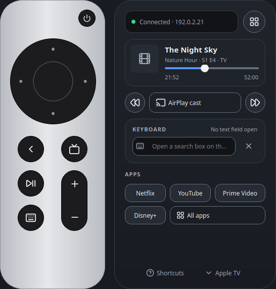
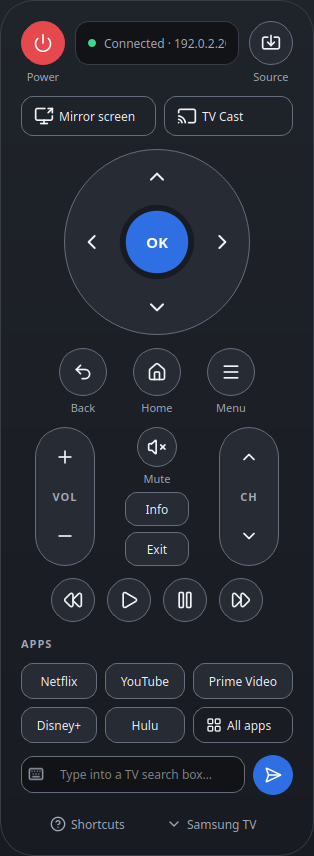
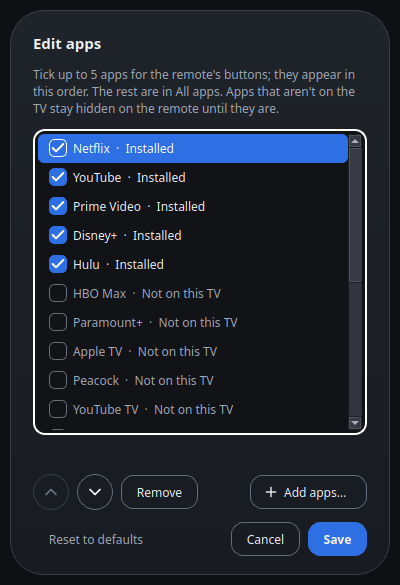

# Samsung & Apple TV Remote

[](https://github.com/baverrr/tv-remote/actions/workflows/tests.yml)
[](LICENSE)

A remote for Samsung TVs and Apple TVs that runs on your Linux or Windows computer. Press keys, open apps, type, and play your own photos, videos and music on the TV.

<p align="center">
  
</p>

> [!TIP]
> You only need one of the two. The Apple TV remote works without a Samsung TV, and the other way round. If you have both, switch between them at the bottom of the window.

> [!IMPORTANT]
> This is an independent project, not made or supported by Samsung or Apple. Their updates can break features. Use it only with TVs you're allowed to control, and cast only content you have the right to show. See the [Terms](TERMS.md).

**[What it does](#what-it-does)** · **[What you need](#what-you-need)** · **[Install](#install)** · **[How to use it](#how-to-use-it)** · **[Help](#help)**

## What it does

- **Works as a remote.** Arrows, OK, Back, Home, volume, channels and media keys, by mouse or keyboard.
- **Opens your apps.** Five app buttons of your choice, and the rest under **All apps**.
- **Types for you.** Type on your computer and the text goes into the TV's search box. On an Apple TV it shows up as you type.
- **Turns the TV on and off.** Samsung TVs turn on with Wake-on-LAN, Apple TVs sleep and wake.
- **Plays your files on the TV.** Photos, videos, music or whole folders on a Samsung TV, and videos and music over AirPlay on an Apple TV.
- **Mirrors your screen** to a Samsung TV, the whole screen or one window.
- **Stays on your network.** It talks to the TV directly and sends nothing to the internet. There's also a command line and a bridge for an ESP32 touch screen remote.

<table>
  <tr>
    <td></td>
    <td></td>
    <td></td>
  </tr>
  <tr>
    <td align="center">The Samsung remote</td>
    <td align="center">Casting files</td>
    <td align="center">Choosing apps</td>
  </tr>
</table>

## What you need

- Linux, or Windows 10 or 11
- Python 3.10 or newer. On Linux, also Qt for Python from your distribution (step 1 below installs it)
- A Samsung TV from 2016 or later (Tizen), or an Apple TV, on the same network as your computer
- Optional: `ffmpeg` for more photo formats, and on Linux `gnome-network-displays` for mirroring

## Install

1. **Linux.** Install Qt for Python, download the project and run the installer. It sets everything up for your user only, no admin needed:

   ```bash
   sudo apt install python3-pyside6.qtwidgets python3-pyside6.qtsvg patch
   git clone https://github.com/baverrr/tv-remote.git ~/.local/share/tv-remote
   ~/.local/share/tv-remote/install.sh
   ```

2. **Windows.** Get Python from [python.org](https://www.python.org/downloads/windows/) or with `winget install Python.Python.3.13`. Then, in PowerShell:

   ```powershell
   git clone https://github.com/baverrr/tv-remote.git "$env:LOCALAPPDATA\tv-remote"
   powershell -ExecutionPolicy Bypass -File "$env:LOCALAPPDATA\tv-remote\install.ps1"
   ```

   No Git? Download the project as a ZIP from GitHub, unpack it there and run the same script.

3. Start it from the app menu or Start menu (**Samsung & Apple TV Remote**), or run:

   ```bash
   tv-remote
   ```

## How to use it

1. **Set up your TV.** For an Apple TV, choose **Set up Apple TV…**, pick it from the list and type the two PINs it shows. For a Samsung TV, put its address in the settings file (below), open the remote and press **Allow** on the TV.
2. **Press keys.** Click the keys, or use your keyboard. Press **?** in the window for the list of shortcuts.
3. **Cast.** Press **TV Cast** (Samsung) or **AirPlay cast** (Apple TV) and pick files, or drag them onto the cast window.
4. **Script it.** Every main action also works from the command line.

<details>
<summary><b>Samsung TV settings and the command line</b></summary>

Settings are in `~/.config/tv-remote/config.json` on Linux and `%APPDATA%\tv-remote\config.json` on Windows. For a Samsung TV, create it with the TV's address and MAC address (for turning it on):

```json
{
  "host": "192.0.2.50",
  "mac": "00:00:5e:00:53:50"
}
```

To turn the TV on from the remote, set **Power On with Mobile** under Settings › General › Network › Expert Settings on the TV.

```sh
tv-remote key volup mute            # keys
tv-remote launch netflix            # open an app
tv-remote text "stranger things"    # type into the TV's on-screen keyboard
tv-remote on | off                  # power
tv-remote cast ~/Pictures/Trip      # cast files or folders; Ctrl+C stops
tv-remote appletv pair              # pair with an Apple TV
```

Commands go to the device you used last. Add `--device samsung` or `--device appletv` to pick one. More in [the details](docs/details.md).
</details>

## Help

**Casting doesn't start.** The TV fetches files from your computer on port 8199. If you use a firewall, let the TV in. See [Firewall](docs/details.md#firewall).

**The Apple TV isn't found.** It must be on the same network. Type its address in the setup window (Settings › Network on the Apple TV).

**The Samsung TV won't turn on.** Some models, like the AU8000, drop off the network in standby. Use the TV's own remote for that.

**Volume doesn't change on the Apple TV.** It needs to control your TV over HDMI-CEC. Or choose **Volume keys control the Samsung TV** in the device menu. See [Apple TV](docs/details.md#apple-tv).

**Updating.** Run `git -C ~/.local/share/tv-remote pull` (on Windows, `git pull` in the folder, then `install.ps1` again), then close and reopen the remote.

<details>
<summary><b>For developers</b></summary>

- Everything else (installers, mirroring, the ESP32 bridge, protocols, limitations): [docs/details.md](docs/details.md)
- How it fits together: [architecture diagram](docs/diagrams/architecture.svg)
- Run the tests (they fake the TVs and never touch the network):

  ```sh
  ./venv/bin/pip install pytest pytest-qt ruff patch-ng
  QT_QPA_PLATFORM=offscreen ./venv/bin/python -I -m pytest -q
  ```

- Re-render the screenshots: `venv/bin/python -I tools/screenshots.py`
</details>

## License

MIT. See [LICENSE](LICENSE), plus the [Terms](TERMS.md) and [Privacy](PRIVACY.md) pages. Icons are from [Lucide](https://lucide.dev) (ISC License).

Not affiliated with Samsung or Apple. "Samsung", "Tizen", "Apple TV", "tvOS", "AirPlay" and "Siri" are trademarks of their owners.
