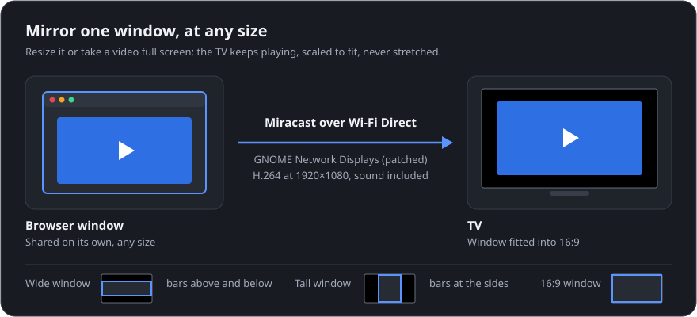
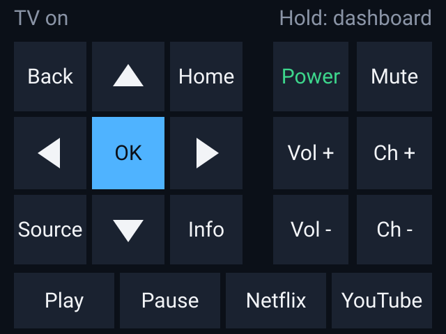

# TV Remote: the details

The full reference for [TV Remote](../README.md): settings, firewall, what the installers do, screen
mirroring, the ESP32 bridge, how it works, the project layout, development and known limitations.

## Contents

- [Setting up in detail](#setting-up-in-detail): [Apple TV](#apple-tv), [Samsung TV](#samsung-tv),
  [firewall](#firewall), [what the installers do](#what-the-installers-do), [updating](#updating)
- [Screen mirroring (Samsung)](#screen-mirroring-samsung)
- [ESP32 bridge](#esp32-bridge)
- [How it works](#how-it-works), [project layout](#project-layout), [development](#development),
  [known limitations](#known-limitations)

## Setting up in detail

Settings are kept in `~/.config/tv-remote/config.json` on Linux and `%APPDATA%\tv-remote\config.json` on
Windows, readable only by you. Set up only the devices you have: with just an Apple TV, skip the Samsung
part entirely.

### Apple TV

Choose **Set up Apple TV…** in the window (it's offered on the first start, and in the device menu at the
bottom), or run `tv-remote appletv pair`. Pick your Apple TV; it shows a PIN twice. The first allows remote
keys and apps, the second now playing and AirPlay casting.

- The Apple TV and the PC must be on the same network, and multicast (Bonjour) must get between them. If
  the Apple TV isn't found, type its address in the setup window (Settings › Network on the Apple TV).
- To pair again, for example after removing the remote under the Apple TV's **Settings › Remotes and
  Devices**, choose **Pair Apple TV again…**.
- **Volume doesn't change?** The Apple TV can only change the TV's volume when it controls it over HDMI-CEC;
  if your Siri Remote works the TV by infrared, no app can. Either set the Apple TV's **Settings › Remotes
  and Devices › Volume Control** to **Auto** (and HDMI-CEC, Anynet+ on Samsung, on the TV), or, if the Apple
  TV is plugged into a Samsung TV that's set up here, choose **Volume keys control the Samsung TV** in the
  device menu. The remote says which when the Apple TV can't. The setting is `volume_via_samsung` under
  `appletv` in the settings file.

### Samsung TV

Create the settings file with your TV's details (the remote adds the rest itself):

```json
{
  "host": "192.0.2.50",
  "mac": "00:00:5e:00:53:50"
}
```

- **`host`:** the TV's IP address. Give the TV a fixed address (a DHCP reservation in your router).
- **`mac`:** the TV's MAC address, for turning it on.
- Optionally **`name`:** what the TV calls this remote ("Linux Remote" or "Windows Remote").

Then:

1. Open the remote. The TV asks to **Allow** it; press Allow. (Denied it? Allow it under Settings › General
   › External Device Manager › Device Connection Manager.)
2. For power-on, turn on Settings › General › Network › Expert Settings › **Power On with Mobile**.

If the TV moves to Wi-Fi, the remote finds it there by itself: after the first contact it remembers the
TV's ID and Wi-Fi address, and if the TV doesn't answer at `host` it tries those, then searches the network
(at most every 30 seconds). Your app choices are saved in the same file; **Edit apps** is the easy way to
change them.

### Firewall

To cast, the TV fetches the file from your PC on port 8199, and the Apple TV also syncs its clock with it
on UDP 8199. A network remote reaches the [ESP32 bridge](#esp32-bridge) on port 8198.

- **Linux with ufw:**

  ```sh
  sudo ufw allow from <TV address> to any port 8199 proto tcp
  sudo ufw allow from <Apple TV address> to any port 8199 proto udp
  ```

- **Windows:** `install.ps1` adds the rules when you run it as administrator. Otherwise it prints them to
  run once in an administrator PowerShell, or you can allow Python on **Private networks** when Windows
  asks the first time you cast.

### What the installers do

<details>
<summary><code>install.sh</code> (Linux)</summary>

- creates `venv/` in the checkout (it also sees your distribution's PySide6) and installs
  `websocket-client` and `pyatv` at the versions in `requirements.lock`, with the AirPlay fix in
  `tools/pyatv-airplay.patch` applied (it needs
  `patch`; without it AirPlay casting stays off and says why);
- installs the `tv-remote` command to `~/.local/bin`;
- adds the menu entry, its "Cast Files to TV…" action, the `tvremote://` link handler and the icon;
- with `--audio`, starts the `tv-mirror-audio` service, which sends sound to the TV while mirroring;
- with `--bridge`, starts the `tv-remote-bridge` service ([ESP32 bridge](#esp32-bridge)).

Optional extras: `ffmpeg` (more photo formats), `gnome-network-displays` (mirroring) and `kdialog`
(start-up error pop-ups).

</details>

<details>
<summary><code>install.ps1</code> (Windows)</summary>

- creates `venv\` in the checkout and installs PySide6, `websocket-client` and `pyatv` at the versions in
  `requirements.lock`, with the AirPlay fix
  applied by `tools/patch_pyatv.py` (Windows has no `patch` command);
- adds the app to the Start menu (it opens without a console window) and registers `tvremote://` links;
- installs the `tv-remote` command and adds it to your PATH;
- with `-Bridge`, adds a scheduled task that starts the bridge when you sign in;
- adds the firewall rules if run as administrator.

Optional: `winget install ffmpeg` for more photo formats. Mirroring is built into Windows.

</details>

Both point at the folder you ran them from; run them again if you move it.

### Updating

```sh
git -C ~/.local/share/tv-remote pull      # Windows: git pull in the folder, then run install.ps1 again
```

Then close and reopen the remote (opening it again only brings the open window forward).

## Screen mirroring (Samsung)

**Mirror screen** opens GNOME Network Displays on Linux, or Windows' own Cast panel (Win+K) on Windows. Pick
the TV there, then press **Allow** on the TV. Choose the whole screen or one window (e.g. your browser);
a shared window keeps streaming while it's covered or minimized. On Windows the sound goes along by itself;
on Linux, install with `--audio` for it. Apps that should stay on your own speakers or headset (Discord,
Zoom, Teams, …) are listed in `~/.config/tv-remote/mirror-audio.json`.

<details>
<summary>Mirroring one window smoothly on Linux (a patched GNOME Network Displays)</summary>

<p align="center">
  
</p>

GNOME Network Displays 0.99 freezes the TV picture and sound when a shared window changes size, including
a video going full screen. `tools/build-gnd.sh` builds a copy with `tools/gnd-window-resize.patch` applied
into `~/.local/opt/gnd`, and the remote uses it from then on:

```sh
tools/build-gnd.sh      # needs Docker; builds in a container, installs nothing else on your system
```

Run it again after `gnome-network-displays` is upgraded; delete `~/.local/opt/gnd` to go back. The patch:

- stops the screen capture from driving the stream's clock, which stopped during a resize and froze
  everything (the fix);
- fits any window shape with black bars instead of stretching it, without restarting the encoder;
- doesn't pause the stream while it waits for the first frame at a new size;
- sends a full picture every second instead of every 10, so the picture recovers quickly after Wi-Fi loss;
- fixes a crash on exit (`free(): invalid pointer`).

</details>

<details>
<summary>Mirroring troubleshooting</summary>

- **"Error" when connecting:** the TV may still hold a previous session. Press **Home** on the TV (or switch
  source) and try again; restarting the TV clears a stuck one. Check you picked the right TV in the list.
- **Choppy picture:** the PC talks to the TV directly over Wi-Fi, so check the signal while mirroring
  (around -60 dBm is good; worse than about -70 dBm stutters):

  ```sh
  for i in $(iw dev | awk '/Interface p2p-/{print $2}'); do iw dev "$i" station dump | grep 'signal:'; done
  ```

- **Wi-Fi power saving** makes the radio doze. To turn it off with NetworkManager (applies on the next
  reconnect; delete the file to undo):

  ```sh
  printf '[connection]\nwifi.powersave = 2\n' | sudo tee /etc/NetworkManager/conf.d/zz-wifi-powersave-off.conf
  sudo nmcli general reload conf
  ```

- **Realtek `rtw89` cards** (e.g. RTL8852BE) have their own power saving that stalls the link and logs
  `timed out to flush queues` (`journalctl -k`). To turn it off (after a reboot; delete the file to undo):

  ```sh
  printf 'options rtw89_core disable_ps_mode=y\noptions rtw89_pci disable_aspm_l1=y disable_aspm_l1ss=y disable_clkreq=y\n' | sudo tee /etc/modprobe.d/rtw89-no-powersave.conf
  ```

</details>

## ESP32 bridge

<p align="center">
  
</p>

`tv-remote serve` lets small devices like an ESP32 touch screen be a remote: they send plain HTTP requests
on your network, and the bridge does the rest through the same remote as the window. It drives whichever
TV is set up (or `--device appletv` / `samsung`).

| Request | Does |
|---|---|
| `POST /key/<key>` | A remote key: `volup` or `KEY_VOLUP` (an Apple TV also takes `select`, `menu`, `play_pause`, …; its `power` sleeps it as `/power/off` does) |
| `POST /launch/<app>` | Opens an installed app: `netflix`, the TV's name for it, or an Apple TV bundle ID |
| `POST /power/on` | Turns the TV on (answers at once, `202`) |
| `POST /power/off` | Turns it off and checks it went off, in the background (`202`) |
| `GET /status` | `{"power": "on"}`, `"standby"` or `"off"` |

Replies are JSON: `{"ok": true, ...}` or `{"error": "..."}`.

**Set it up:**

1. Install with `./install.sh --bridge` (Linux) or `install.ps1 -Bridge` (Windows), so it starts by itself.
2. Get the token with `tv-remote serve --token`. Every request needs `Authorization: Bearer <token>`.
3. Optionally limit who can connect: `"bridge_clients": ["192.0.2.30"]` in the settings file (a list; one address on its own also works).
4. Let the device through your firewall: `sudo ufw allow from <ESP32 address> to any port 8198 proto tcp`.

The token travels unencrypted on plain HTTP: fine on a home network, but don't forward the port to the
internet. A connection that sends nothing for 15 seconds is closed (ESPHome simply reconnects).

<details>
<summary>An ESPHome example, and status codes</summary>

```yaml
http_request:
  timeout: 3s

script:
  - id: tv_send
    mode: queued
    parameters:
      path: string
    then:
      - http_request.post:
          url: !lambda return std::string("http://192.0.2.10:8198") + path;
          request_headers:
            Authorization: "Bearer change-me"

button:
  - platform: template
    name: TV Volume Up
    on_press:
      - script.execute: {id: tv_send, path: /key/volup}
```

Errors answer `400` (a key the TV doesn't have), `401` (token), `403` (address not allowed), `404`
(unknown request or app) or `502` (the TV didn't answer or refused). `"bridge_listen"` in the settings
picks the address to listen on (default: all).

The touch remote in the picture is a "Cheap Yellow Display" (ESP32-2432S028R) build. It also sends the IR
power code (`remote_transmitter.transmit_samsung: {data: 0xE0E040BF}`) through an IR LED, which turns on
TVs that ignore Wake-on-LAN.

</details>

## How it works

<p align="center">
  
</p>

Both TV clients offer the same methods (keys, text, apps, power, casting), so the window, the command line
and the bridge work the same whichever TV they drive. The Samsung client also wakes the TV with Wake-on-LAN. The diagram is
drawn with [archgram](https://github.com/byabas/archgram) from
[`docs/diagrams/architecture.archgram.yaml`](diagrams/architecture.archgram.yaml), in the remote window's colours.

<details>
<summary>The protocols, in detail</summary>

**Apple TV**, through [pyatv](https://pyatv.dev):

| What | How |
|---|---|
| Finding it | mDNS (Bonjour). It's remembered by its identifier, so a new address doesn't matter: the last one is tried first, then the network is searched. |
| Pairing | Companion, then AirPlay, each with a 4-digit PIN shown on the TV. The credentials are saved in the settings file. |
| Keys, apps, typing, power | The Companion protocol. |
| Now playing | MRP, tunnelled through AirPlay: the box reports changes, and the window's clock runs in between. |
| AirPlay cast | The cast server (TCP 8199, only to the Apple TV's address), with the box's clock sync on UDP 8199. tvOS 26 and later need an AirPlay fix that isn't in a pyatv release yet, so the installers apply `tools/pyatv-airplay.patch` (from [pyatv#2846](https://github.com/postlund/pyatv/pull/2846)). |

**Samsung TV:**

| What | How |
|---|---|
| Keys and text | WebSocket on `wss://TV:8002`. The first connection shows an **Allow** prompt; the pairing token is saved, with the fingerprint of the TV's self-signed certificate. The token is only sent to that certificate: a TV showing another one (a reset, a different TV, or something posing as it) gets the **Allow** prompt again instead. |
| Apps | REST on `http://TV:8001/api/v2/applications/<id>`: each known app ID is checked (404 = not installed), and apps open with a POST. |
| Power | `http://TV:8001/api/v2/` reports on or standby; power-on is a Wake-on-LAN packet. |
| Casting | The TV's DLNA renderer (port 9197). A small server on the PC (port 8199) serves only the file that's playing, only to the TV, under a link that stops working when the queue moves on. |
| Mirroring | GNOME Network Displays (Miracast over Wi-Fi Direct); `mirror_audio.py` routes sound through PipeWire while it streams. On Windows, Windows' own Cast panel. |

</details>

## Project layout

| File | What it is |
|---|---|
| `tv_remote.py` | Samsung TV client, settings, device choice, command line, entry point |
| `appletv.py` | Apple TV client on pyatv: pairing, discovery, the AirPlay cast renderer |
| `remote_qt.py` | The windows (Samsung remote, Siri Remote, cast, Apple TV setup) and their styling |
| `cast.py` | Casting: the file server, the DLNA client and the play queue |
| `bridge.py` | The ESP32 bridge (`tv-remote serve`) |
| `mirror_audio.py` | Sound routing while mirroring on Linux (a user service) |
| `install.sh`, `packaging/` | Linux install, with the menu entry and service templates |
| `install.ps1`, `tools/patch_pyatv.py`, `tools/make_icon.py` | Windows install, and the helpers it runs |
| `requirements.in`, `requirements.lock` | What the installers ask for, and every package they install at one tested version (pip constraints; how to regenerate is in the lock's header) |
| `tools/pyatv-airplay.patch` | pyatv's unreleased AirPlay fix for tvOS 26+ |
| `tools/build-gnd.sh`, `tools/gnd-window-resize.patch` | The patched GNOME Network Displays build |
| `tools/screenshots.py` | Re-renders the screenshots in `docs/images/` |
| `test_*.py` | Tests (TVs, PipeWire and the Windows APIs are faked; nothing touches the network) |
| `conftest.py` | Shared test setup: no test opens a TLS connection to a TV |
| `docs/`, `icons/`, `tv-remote.svg` | This page, screenshots and pictures (`docs/images/`), Lucide icons, the app icon |
| `docs/diagrams/`, `archgram.theme.json` | The README's architecture diagram: its archgram spec, the SVG drawn from it, and its colours |
| `.gitattributes` | Keeps the patch and shell scripts at LF line endings on Windows checkouts |

## Development

```sh
./venv/bin/pip install pytest pytest-qt ruff patch-ng  # patch-ng: Windows' patcher, so pyright resolves tools/
QT_QPA_PLATFORM=offscreen ./venv/bin/python -I -m pytest -q
./venv/bin/ruff check .
pyright
```

On Windows: `.\venv\Scripts\pip install pytest pytest-qt ruff`, then
`$env:QT_QPA_PLATFORM = "offscreen"; .\venv\Scripts\python -I -m pytest -q`.

The tests run offscreen against stubs, with a temporary settings file, so they never talk to a real TV.
CI runs them on Linux (Python 3.10–3.14) and Windows, and runs `install.ps1` on a Windows machine. Day-to-day
use has been on Ubuntu 26.04 with KDE Plasma (Wayland), with a 2021 Samsung AU8000 and an Apple TV 4K (3rd
generation, tvOS 27).

## Known limitations

- **Windows has been tested on GitHub's machines,** not yet against a TV from a Windows PC.
- **Wake-on-LAN is unreliable on some Samsung models.** The AU8000 drops off the network in standby, so
  turning it on often needs the physical remote, or an IR LED on an [ESP32 remote](#esp32-bridge).
- **Samsung app IDs come from community lists.** Samsung doesn't publish them; a wrong one just shows the
  app as "Not on this TV". Others can be added by ID (Edit apps › Add apps… › Advanced).
- **Casting needs the remote open:** files stream from your PC. Casting uses the remote's volume keys (the
  DLNA volume isn't the TV's).
- **One TV of each kind:** one Samsung TV and one Apple TV.
- **Apple TV:**
  - AirPlay casting needs the patched pyatv the installers set up; without it the cast button is greyed out
    and says why. It plays videos and music, not photos, in formats the Apple TV plays (MP4/MOV with H.264
    or HEVC; not MKV).
  - No mute (Apple's remote protocol has none) and no mirroring from Linux.
  - The keyboard replaces the whole text field after each pause in typing, which is how tvOS takes it.
